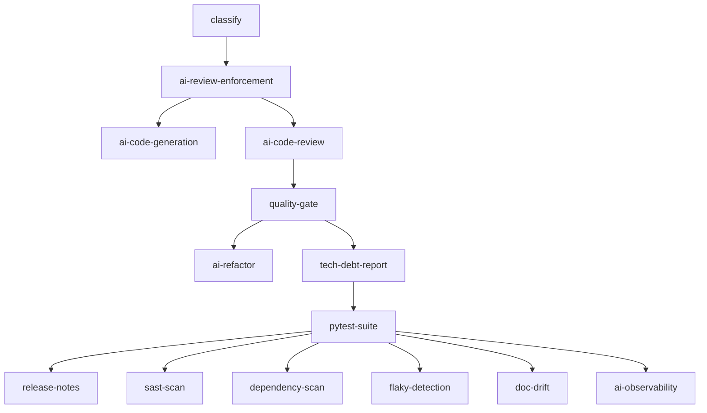

# Session Goal: KAN-308 Phase 4 — Release Automation, Quality Hardening & AI Governance Observability

## Epic Context
**Parent:** KAN-289 AI-SDLC Transformation  
**Phase:** 4 of 4 (Phases 0-3 complete)  
**Jira:** [KAN-308](https://pansakorn.atlassian.net/browse/KAN-308)

---

## Phase 4 Scope (Merged: Observability + Release Automation)

### 4A Release Notes Automation
- Auto-generate release notes from merged PRs (conventional commits)
- Categorize: Features, Fixes, Breaking Changes, Security, Dependencies
- Integrate with GitHub Releases + CHANGELOG.md
- Trigger on tag push / main merge

### 4B Security Scanning Enhancement
- Extend gitleaks with custom rules for project-specific patterns
- Add SAST scanning (CodeQL / Semgrep) in CI
- Dependency vulnerability scanning (OSV / Dependabot alerts → auto-PR)
- Secret rotation verification in CI (M6 completion)

### 4C Test Maintenance Automation
- Flaky test detection & quarantine (track across runs)
- Snapshot test auto-update on intentional changes
- Test coverage regression detection (fail if coverage drops >5%)
- AI-assisted test generation for untested code paths (extend KAN-305)

### 4D Documentation Sync
- Auto-detect doc/code drift (OpenAPI, README, ARCHITECTURE.md)
- Generate API docs from code annotations
- Sync architecture diagrams from code structure
- Validate code examples in docs actually compile/run

### 4E AI Governance Observability
- LangSmith/MLflow integration for agent tracing
- AI-powered anomaly detection in CI/CD metrics
- Dashboard for SDLC health (cycle time, defect rate, provenance compliance)
- **No control authority** — alerting only, human decides all actions

---

## Implementation Approach

### Unified CI Pipeline (ci.yml)
- Add new jobs after existing `pytest-suite`:
  - `release-notes` — generates notes on tag push
  - `sast-scan` — CodeQL/Semgrep security scan
  - `dependency-scan` — OSV/Dependabot vuln scan + auto-PR
  - `flaky-detection` — track/test flakiness across runs
  - `doc-drift` — detect documentation/code drift
  - `ai-observability` — emit traces, anomaly detection, dashboard update

### Leverage Existing Infrastructure
- **gemini-web-bridge** / **aipass-web-bridge** for AI tasks (same as Phases 1-3)
- **Phase 3 tech_debt_tracker.py** for trend analysis (complexity, duplication, debt ratio)
- **Phase 2 ai_code_review.py** / **quality_gate.py** patterns for new agents
- **Test provenance guard** for all new test files (baseline commit tracking)

### TDD Pattern (Required)
1. Write failing tests first (RED) in `tests/test_phase4_*.py`
2. Implement in `scripts/phase4_*.py`
3. Run tests to GREEN
4. Add CI jobs
5. Verify with provenance guard

---

## Acceptance Criteria

### Release/Quality (4A-4D)
- [ ] Release notes auto-generated on every release tag
- [ ] SAST scan runs in CI with zero critical findings
- [ ] Dependency vulnerability PRs auto-created weekly
- [ ] Flaky test dashboard shows <5% flake rate
- [ ] Doc drift detection alerts on every PR
- [ ] All Phase 4 CI jobs integrated in unified pipeline

### Observability (4E)
- [ ] All agents emit structured traces (OpenTelemetry)
- [ ] LangSmith/MLflow receives traces
- [ ] Anomaly detection alerts on regressions
- [ ] Dashboard shows: cycle time, defect rate, provenance compliance
- [ ] Zero control authority — human decides all actions

---

## Technical Constraints

| Constraint | Detail |
|------------|--------|
| Python | 3.9.6 (use `Dict`, `List`, `Optional` from `typing` — no `|` union syntax) |
| CI | GitHub Actions, unified pipeline in `.github/workflows/ci.yml` |
| Bridges | gemini-web-bridge (port 8765), aipass-web-bridge (port 8766) — graceful fallback required |
| Provenance | Every test file needs `plans/test_provenance/ticket-kan-308-*.json` with baseline SHA |
| Trailer | All source commits: `Test-Baseline: KAN-308` |
| Branching | Continue on `feature/KAN-306-ai-code-review` (same branch as Phases 2-3) |

---

## File Targets (New)

| Path | Purpose |
|------|---------|
| `tests/test_phase4_release_notes.py` | Release notes generation tests |
| `tests/test_phase4_security.py` | SAST/dependency scan tests |
| `tests/test_phase4_flaky.py` | Flaky test detection tests |
| `tests/test_phase4_doc_sync.py` | Doc drift detection tests |
| `tests/test_phase4_observability.py` | Observability/agent tracing tests |
| `scripts/release_notes.py` | Release notes generator |
| `scripts/sast_scan.py` | SAST scanner wrapper |
| `scripts/dependency_scan.py` | Dependency vulnerability scanner |
| `scripts/flaky_detector.py` | Flaky test tracker |
| `scripts/doc_drift.py` | Documentation drift detector |
| `scripts/ai_observability.py` | Agent tracing + anomaly detection |
| `scripts/create_release_pr.sh` | CI helper for release PR |
| `plans/test_provenance/ticket-kan-308-*.json` | Provenance manifests (one per test file) |

---

## CI Job Dependencies

---

## Milestones

| Milestone | Target |
|-----------|--------|
| M1: Release Notes + Security tests (RED) | Day 1 |
| M2: Release Notes + Security implementation (GREEN) | Day 2 |
| M3: Flaky + Doc Sync tests (RED) | Day 3 |
| M4: Flaky + Doc Sync implementation (GREEN) | Day 4 |
| M5: Observability tests (RED) | Day 5 |
| M6: Observability implementation (GREEN) | Day 6 |
| M7: CI integration + provenance guard pass | Day 7 |
| M8: PR created, CI green, merged | Day 8 |

---

## Risk Mitigation

| Risk | Mitigation |
|------|------------|
| Bridge unavailable in CI | Graceful fallback to static analysis only |
| Python 3.9 syntax | Use typing module imports consistently |
| CI YAML corruption | Use external shell scripts for complex steps (proven in Phase 3) |
| Provenance failures | Run guard locally before push; fix baseline SHAs |
| Flaky test noise | Use Phase 3 tech_debt_history.json for baseline comparison |

---

## References
- Phase 0 (KAN-290): 14 mitigations — PR #274, #275
- Phase 1 (KAN-305): AI Code/Test Generation — PR #276
- Phase 2 (KAN-306): AI Code Review & Quality Gates — PR #277
- Phase 3 (KAN-307): AI Refactoring & Tech Debt — same branch, latest commits
- CI Workflow: `.github/workflows/ci.yml` (907 lines, unified pipeline)
- Test Provenance: `scripts/test_provenance_guard.py`