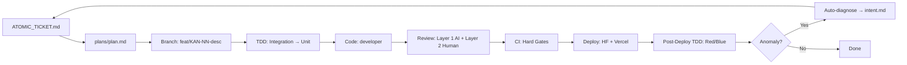

# PROJECT.md — HoroConsultant Architecture Baseline

**Version:** 1.0  
**Date:** 2026-10-30  
**Status:** Active Baseline  
**Owner:** Hermes Orchestrator (Kim Leng Lim)

---

## 1. Architecture Baseline

### 1.1 System Overview
HoroConsultant is an AI-assisted SDLC orchestration platform that runs on macOS (Apple Silicon) as the developer control plane, with GitHub Actions CI/CD for cloud verification, and deploys to Hugging Face Spaces (Docker) and Vercel (Edge).

### 1.2 Core Components

| Component | Technology | Purpose |
|---|---|---|
| **Orchestrator** | Hermes Agent (local) | Autonomous task dispatch, routing, governance |
| **Agent Fleet** | AGY (5 accounts) + Codex (3 accounts) | Parallel coding, testing, review |
| **Local Compute** | Ollama (GPT-OSS 120B) | Zero-marginal-cost fallback |
| **Web Bridges** | Cloudflare Workers (Gemini, AIPASS) | API adapter layer |
| **CI/CD** | GitHub Actions | Hard fail-closed gates |
| **Issue Tracking** | Jira Cloud (KAN project) | Source of truth for work items |
| **Secrets** | Doppler (prd_worker config) | Secret management |
| **Observability** | Grafana Cloud (OTLP) | Metrics, traces, logs |

### 1.3 System Boundaries
- **Local (Developer Mac):** Hermes, hooks, agent CLIs, Ollama, web bridges
- **CI (GitHub Actions):** Unified CI, AI Safety Audit, Jira Governance, Post-deploy TDD
- **Production:** HF Spaces (backend), Vercel (gateway/API)
- **External:** Jira, Doppler, Grafana, Cloudflare Workers

---

## 2. Tech Stack

| Layer | Technology | Version / Constraint |
|---|---|---|
| **OS** | macOS | 26.x (Apple Silicon M-series) |
| **Shell** | zsh | 5.9+ |
| **Package Manager** | Homebrew | Latest |
| **Python** | CPython | 3.11+ (locked via pyproject.toml) |
| **Node.js** | Node | 20 LTS (for Cloudflare Workers) |
| **Runtime (Local LLM)** | Ollama | 0.3+ with gpt-oss:120b (4-bit) |
| **Container** | Docker | 24+ (HF Spaces deployment) |
| **CI** | GitHub Actions | ubuntu-latest runners |
| **Language (Core)** | Python | 3.11, type hints mandatory |
| **Language (Workers)** | TypeScript | 5.3+, strict mode |
| **Testing** | pytest | 7.4+ with test_provenance_guard |
| **Static Analysis** | ruff, bandit, radon | Latest (version-locked) |
| **Git Hooks** | husky-style (custom .githooks/) | Advisory local, enforced CI |

### 2.1 Legacy Tech Stack Reference (from original PROJECT.md)
- **Language:** Python 3.10+ (backend), TypeScript/JavaScript (Cloudflare Workers)
- **Framework:** FastAPI (backend), Next.js (frontend via Cloudflare Pages)
- **Database:** SQLite (local metrics), Cloudflare D1 (production), Cloudflare KV (artifacts)
- **AI/ML:** transformers==4.44.2, peft==0.12.0 (locked)
- **Infra:** Cloudflare Workers, Cloudflare Pages, GitHub Actions, Docker
- **Secrets:** Doppler (project: gemini-web-bridge, config: prd_worker)
- **Testing:** pytest (Python), node --test (JS/TS)
- **Linting:** ruff, bandit

---

## 3. Runtime Constraints

### 3.1 macOS Resource Limits (Hard Ceilings)
| Resource | Limit | Enforcement |
|---|---|---|
| **File Descriptors** | 65,536 | `ulimit -n` + launchd HardResourceLimits |
| **Unified Memory** | Monitor via `memory_pressure` | Fail-closed if < 20% free (awk-based check) |
| **Thermal** | Throttle at 90°C | Reduce effort profile / defer to cloud |
| **Battery** | Pause heavy compute < 20% | Switch to cloud fallback |

### 3.2 Agent Concurrency Limits
| Pool | Max Concurrent | Quota Source |
|---|---|---|
| AGY (per account) | 2 | AGY dashboard (RPM/TPM) |
| Codex (shared pool) | 3 | ChatGPT Plus/Team quota |
| Local (GPT-OSS 120B) | 1 | Unified memory (65-75 GB) |

### 3.3 Network & Latency Budgets
| Path | Budget | Fallback |
|---|---|---|
| Local hook (pre-commit) | < 5s | Skip if timeout |
| Local hook (pre-push) | < 15s | Warn, don't block |
| CI (ai_cicd.yml) | < 10 min | Fail build |
| CI (post-deploy-tdd) | < 30 min | Async, non-blocking merge |
| Web Bridge health probe | 1500ms | Mark unhealthy, promote tier |

---

## 4. Governance Rules (Immutable)

1. **Zero-Assumption:** Never invent infrastructure params — always `${ENV_VAR}` or probe
2. **Fail-Closed:** Unverified route → cut immediately → promote next tier if probed healthy
3. **Local = Advisory:** `.githooks/*` are non-blocking; CI = Hard Fail-Closed
4. **Human Authority:** 3 points only — Scope/Priority, Quality Acceptance, Release Authorization
5. **Single Source of Truth:** Repo Markdown primary (`ATOMIC_TICKET.md`, `plans/plan.md`); Jira synced via commit SHA
6. **No Speculative Coding:** Agents must declare target files in `plan.md`; gate blocks off-spec edits
7. **Read-Before-Modify:** Every subagent must read `docs/TASKS.md` and `docs/PROJECT.md` before work
8. **Prompts as Production Code:** `.agents/rules/*`, `SKILL.md` versioned, regression-tested via `tests/evals/sample_diffs/`

---

## 5. Data Flow Invariants



---

## 6. Specialist List & Agent Matrix (Legacy Reference)

| Agent Identifier | Role / Specialty | Primary Focus & Path Ownership | Bound Skills |
|---|---|---|---|
| **`orchestrator`** | Coordination & Autonomous Execution | Decomposition, dispatch, gate decisions, conflict resolution | `orchestrator-delegation`, `multi-account-agent-orchestration` |
| **`lead_ba`** (`business_analyst`) | Lead Business Analyst | Master ticket writer (`ATOMIC_TICKET.md`, `plans/plan.md`) | `bsa-doc-skill-management`, `agile-governance` |
| **`ba_intake`** | Intake & 9-Dimension Grill Specialist | Canonical intake interview, scope validation, writes exclusively to `plans/intake/<sprint>.md` | `requirement-grill-gate`, `bsa-doc-skill-management` |
| **`ba_auditor`** | Read-Only Audit & Verification Specialist | Read-only audit of DoR, DoD, test provenance, and evidence receipts | `agile-governance`, `qa-e2e-testing` |
| **`developer`** | Senior Full-Stack Developer | Implementation across assigned module lanes | `sdlc-aisdlc-workflow` |
| **`qa_tester`** | QA Tester & Verification Guard | Test baselines, contract tests, and regression verification (`tests/**`) | `qa-e2e-testing`, `hf-static-release-verification` |
| **`code_reviewer`** | Pre-Deployment Safety Auditor | Security review, secret scan, and AST verification | `qa-e2e-testing`, `hf-static-release-verification` |
| **`devops`** | DevOps & Release Agent | Release tags, packaging, deployment, and environment hygiene | `devops-deployment`, `hf-static-release-verification` |
| **`ux_ui_designer`** | UX/UI Designer & Color Architect | Design tokens, color palettes, UI components | `web-color-design` |
| **`ui_visual_tester`** | UI Visual Tester & Layout Auditor | Multi-viewport screenshot capture and DOM overlap audit | `ui-visual-auditor` |

---

## 7. 6-Lane Concurrency Architecture (Legacy Reference)

The ecosystem enforces a maximum 6-lane concurrency architecture divided into two operational tiers:

1. **Management Tier (up to 3 lanes):**
   - `lead_ba`: Master ticket writer and roadmap planner. Sole writer of `ATOMIC_TICKET.md` and `plans/plan.md`.
   - `ba_intake`: Intake & 9-Dimension Grill Gate Specialist. Conducts intake and writes exclusively to `plans/intake/<sprint-or-topic>.md`. Never writes directly to `ATOMIC_TICKET.md` or `plans/plan.md`.
   - `ba_auditor`: Read-only audit and verification specialist. Audits Definition of Ready (DoR), Definition of Done (DoD), test provenance manifests, and evidence receipts. Strictly read-only; never mutates plans or source files.

2. **Parallel Execution Tier (up to 3 concurrent lanes):**
   - `developer_api`: API Gateway and routing layer. Writable paths: `project/routers/**`, `api/index.js`, `vercel.json`.
   - `developer_core`: Computation and core logic. Writable paths: `project/core/**`, `rust_core/**`.
   - `qa_tester`: Test baselines and verification. Writable paths: `tests/**`, `plans/test_provenance/**`.

3. **Resource Isolation & Path Disjointness:**
   - Strict one-editor-per-resource ownership.
   - All concurrent lanes must have mutually disjoint writable paths.
   - Fail-closed locking: if tasks share files across lane boundaries, execution falls back to sequential execution.

---

## 8. File Placement Rules (Legacy Reference)

- **Root README (`/README.md`):** สงวนไว้เฉพาะภาพรวมระดับสูงของโปรเจกต์ (High-level overview), วิธีติดตั้งเบื้องต้น (Quick Start), และลิงก์ชี้ไปยังคู่มือฉบับเต็มเท่านั้น ห้ามใส่เนื้อหาทางเทคนิคละเอียดไว้ที่ Root
- **Detailed Docs (`./docs/`):** เอกสารทางเทคนิคทั้งหมด, รายละเอียดสถาปัตยกรรม (Architecture), และคู่มือ API ต้องสร้างและจัดหมวดหมู่อยู่ภายใต้โฟลเดอร์ `./docs/` ทั้งหมด
- **Sidebar Index (`/SUMMARY.md` หรือ `./docs/SUMMARY.md`):** เมื่อสร้างไฟล์เอกสารใหม่ ให้เพิ่มลิงก์เข้าสารบัญนี้เสมอ เพื่อให้โครงสร้างเมนูบน GitBook ซิงก์แสดงผลถูกต้อง
- **Naming Convention:** โฟลเดอร์และไฟล์ Markdown ย่อยทั้งหมดต้องใช้รูปแบบ `kebab-case` (เช่น `./docs/api-guide/user-auth.md`)

---

## 9. Project Safeguards (Legacy Reference)

- Apply the relevant `.agents/rules/` documents and skills for the task at hand.
- Kaggle synchronization, deployment, publishing, external messages, and secret operations are opt-in: perform them only when the user requests them or the current task requires them.
- Before release claims, run the relevant tests and `python3 scripts/sync_ai_agent_ecosystem.py --check`.
- Plan Completion, Archival & Release Notes Mandate (Core Rule 16 / Rule 22): Whenever all milestones or tickets in an active plan or sprint are executed and verified DONE, archive completed planning artifacts from `plans/` to `plans/archive/YYYY-MM-DD-<sprint-or-release>/`, maintain `/plans/` containing only active/upcoming specifications, and compile/publish `ReleaseNotes.md` with Executive Summary, Architectural Deliverables, Verification Matrix, Milestone Rollup (100% DONE), Live Production Endpoints, and Archived Plans list. Governed by `business_analyst` and `orchestrator`. See `.agents/rules/22-plan-completion-and-release-notes.md`.

---

## 10. Architecture Overview (Legacy Reference)

See `docs/ARCHITECTURE.md` for full system architecture. Key components:

- **MCP Transport Layer:** `project/mcp_transport_hardening.py` — bounded buffers, circuit breakers, origin validation, session rotation, FD budget, cold-start timeout, doc-index provenance, graceful degradation, failover security floor
- **Agent Ecosystem:** `.agents/` (legacy) + `.codex/` (generated) + `skills/` (native Codex)
- **Cloudflare Workers:** `cloudflare-worker/` — Gemini web bridge, AIPASS bridge
- **Governance:** `.githooks/`, `scripts/test_provenance_guard.py`, `scripts/tdd_gate.py`

---

## 11. ADR Index

See `docs/adr/` for architectural decision records. Template: `docs/adr/0001-template.md`.

---

## 12. Versioning & Change Control

- **PROJECT.md** changes require ADR (Architecture Decision Record)
- **ADR** template: `docs/adr/NNNN-title.md`
- **Tech stack changes** = Tier 3 → Full ADR + Human approval
- **Runtime constraint changes** = Tier 3 → ADR + Hermes restart

---

## 13. Appendices

### 13.1 Environment Variables (Required)
```bash
# ~/.hermes.env (chmod 600)
GEMINI_MAX_RPM=1000
GEMINI_MAX_TPM=1000000
CODEX_QUOTA_MODE=shared
CODEX_ACCESS_LAYER=direct
CODEX_MCP_SERVER_NAME=codex-runtime-mcp
GPT_OSS_MODE=local
GPT_OSS_ZERO_COST=true
GEMINI_BRIDGE_MODEL=gemini-4-argon
AIPASS_EMERGENCY_MODELS=claude-opus-5.5,gpt-6-luna,deepseek-r1
```

### 13.2 Run Commands (Legacy Reference)

```bash
# Backend tests
.venv/bin/python -m pytest project/tests/ -q

# Cloudflare Worker tests
cd cloudflare-worker && node --test

# Sync agent ecosystem
python3 scripts/sync_ai_agent_ecosystem.py --sync
python3 scripts/sync_ai_agent_ecosystem.py --check

# Test provenance guard
python3 scripts/test_provenance_guard.py staged
```

### 13.3 Key File Locations
| Artifact | Path |
|---|---|
| Soul Document | `~/Library/Application Support/hermes/soul.md` |
| Routing Config | `~/Library/Application Support/hermes/hermes-routing.config.yaml` |
| Env File | `~/.hermes.env` |
| Launch Agent | `~/Library/LaunchAgents/com.hermes.agent.plist` |
| Wrapper Script | `~/.hermes/bin/hermes-runner.sh` |
| Logs | `~/Library/Logs/hermes/` |
| Metrics | `metrics/ai_sdlc_metrics.jsonl` |
| ADRs | `docs/adr/` |

---

*This document is the authoritative architecture baseline. All agents must read before modifying any system component.*