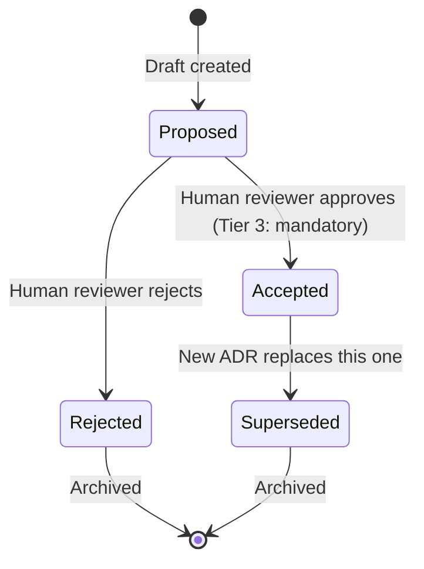

# ADR Template — HoroConsultant

**ADR Number:** 0001  
**Title:** [Short descriptive title, e.g., "Adopt Integration-First TDD Order"]  
**Date:** YYYY-MM-DD  
**Status:** Proposed | Accepted | Superseded | Rejected  
**Authors:** [Name(s)]  
**Reviewers:** [Name(s) — at least 1 human for Tier 3]  
**Supersedes:** [ADR-NNNN if applicable]  
**Superseded-by:** [ADR-NNNN if applicable]

---

## Context

What is the issue that motivates this decision? What is the current state?

- **Problem:** [Describe the problem in 2-3 sentences]
- **Current State:** [How things work today]
- **Trigger:** [What event or analysis prompted this ADR? e.g., "Cross-functional review CFR-85B39A1DCA15 identified gap #2"]

---

## Decision

What is the change we are making?

**We will:** [State the decision clearly and actionably]

---

## Alternatives Considered

| Alternative | Pros | Cons | Why Not Selected |
|---|---|---|---|
| [Option A] | | | |
| [Option B] | | | |
| [Option C] | | | |

---

## Consequences

### Positive
- [Benefit 1]
- [Benefit 2]

### Negative
- [Cost/Risk 1]
- [Cost/Risk 2]

### Neutral
- [Migration effort, learning curve, etc.]

---

## Implementation Plan

| Step | Action | Owner | Verification |
|---|---|---|---|
| 1 | [Specific action] | [Role/Person] | [How to verify] |
| 2 | [Specific action] | [Role/Person] | [How to verify] |
| 3 | [Specific action] | [Role/Person] | [How to verify] |

---

## Verification Criteria (Gate Requirements)

This ADR is considered **implemented** when:

- [ ] [Measurable criterion 1, e.g., "tdd_gate.py enforces Integration→Unit order for all Tier 2+ changes"]
- [ ] [Measurable criterion 2, e.g., "CI passes with new test order on 5 consecutive runs"]
- [ ] [Measurable criterion 3, e.g., "Zero flaky integration tests in baseline"]

---

## Risk Tier Classification

**Tier:** 1 (Docs/Config) | 2 (Standard Feature) | 3 (Core/Security/Model Promotion)

> **Rule:** Tier 3 changes **require accepted ADR before TDD starts**. `tdd_gate.py` enforces this as hard fail-closed gate.

---

## Related Artifacts

- **Jira Ticket:** KAN-NNNN
- **Commit SHA:** [Will be filled on merge]
- **Branch:** feat/KAN-NNNN-description
- **Cross-functional Review:** CFR-XXXXXXXXXXXX
- **Plan:** plans/plan.md (section X.Y)

---

## Appendix: ADR Lifecycle

---

## Appendix: Template Usage

1. Copy this file to `docs/adr/NNNN-short-title.md` (next sequential number)
2. Fill in all sections — **no section may be left blank**
3. For Tier 3: Get human reviewer approval before marking `Accepted`
4. Link from `plans/plan.md` and Jira ticket
5. On merge: Update `Status` to `Accepted`, fill `Commit SHA`
6. If superseded: Update both old and new ADRs with cross-references

---

*Template version: 1.0 | Maintained by Hermes Orchestrator | See `docs/PROJECT.md` for governance rules*